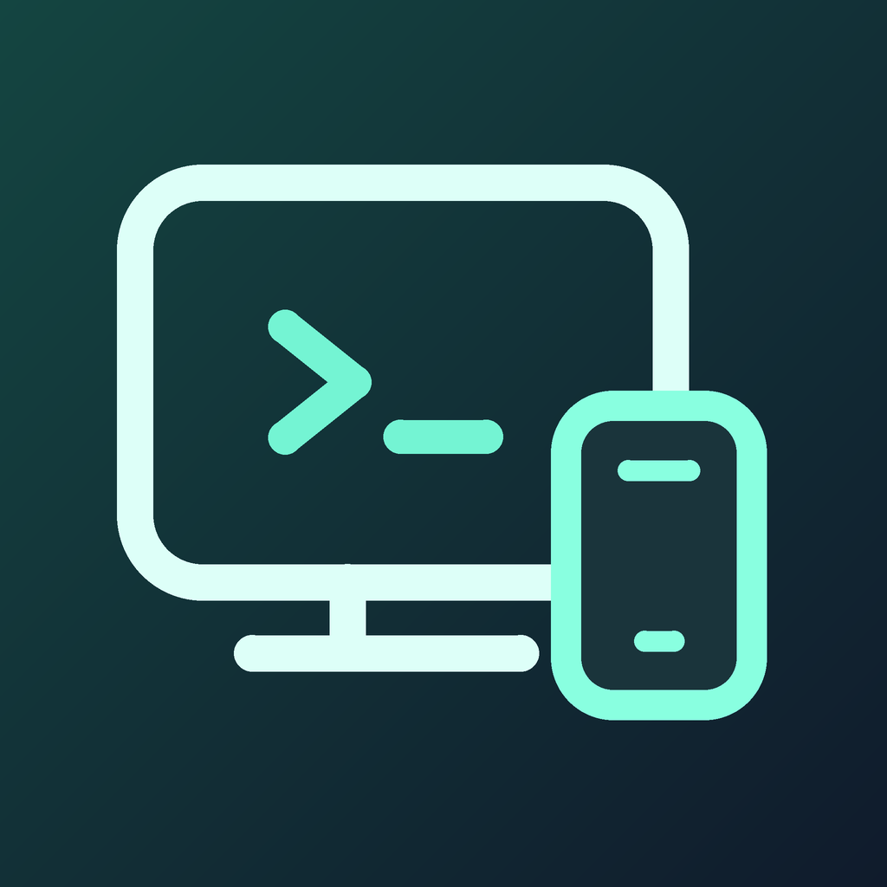
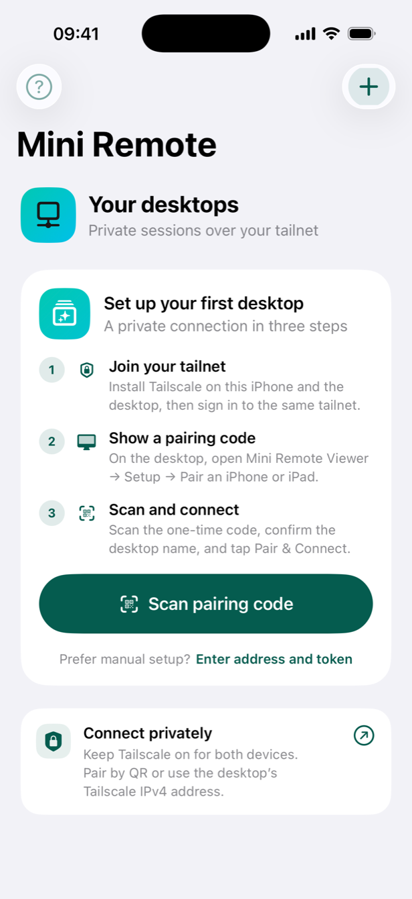
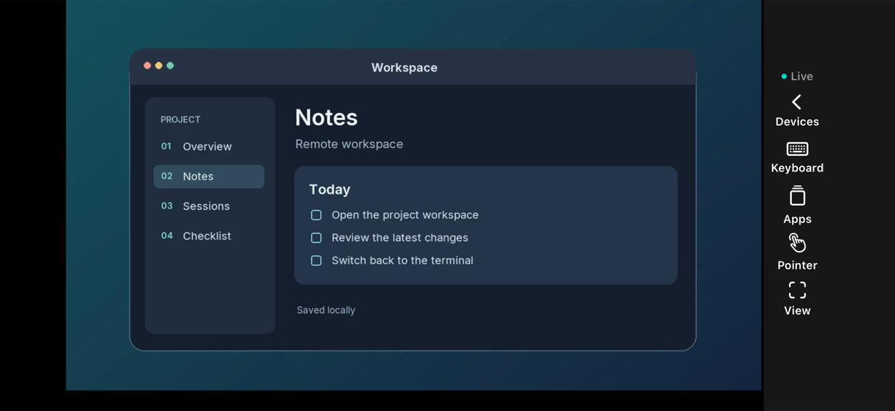

# Mini Remote



Mini Remote is an open-source remote desktop for macOS and Linux hosts, built in Rust. Connect from another desktop, an iPhone, or an iPad over Tailscale. It streams the desktop using H.264 and carries keyboard input, pointer input, and optional two-way text clipboard through the same authenticated session.

For iPhone and iPad, see the [mobile setup guide](mobile/ios/README.md). Pair with a one-time QR code from **Setup → Pair an iPhone or iPad** in the desktop viewer.

## iPhone screenshots





## Requirements

- Tailscale is running and both machines are signed in. If your tailnet policy restricts traffic, allow the viewer to reach the host on TCP 47990.
- FFmpeg is available on both machines. On Apple silicon, use a build with AVFoundation and VideoToolbox. On Linux, use a build with NVENC, VA-API, or the libx264 software encoder.
- The Linux host uses a compatible wlroots Wayland desktop such as Budgie with labwc. Install the wl-clipboard utilities for text clipboard. The on-screen desktop and compositor must be running.
- On macOS, grant **Screen & System Audio Recording** and **Accessibility** in **System Settings → Privacy & Security** to the app that launches the connector. Grant permission to **Mini Remote Connector** when launching the installed app. If needed, run the bundled executable with `permissions --request` to open the macOS authorization prompts.

## Install and connect

Build these packages on each platform with a Rust toolchain and Python 3.

```sh
python3 scripts/package.py --install
```

On macOS, this installs **Mini Remote Viewer** and **Mini Remote Connector** in your user Applications folder. On Linux, this installs the viewer in your app menu and the connector in `~/.local/bin`. Add `--autostart` to the install command to start the connector at login.

Open **Setup** in the viewer to revisit the first-run guide. The macOS menu bar icon shows whether the connector process is running and provides connector controls, **Pair Phone**, and **Setup**. On Linux, the optional tray needs a StatusNotifier-capable panel and GTK 3 plus Ayatana AppIndicator or AppIndicator bindings. The tray starts at desktop login when those dependencies are available. On iPhone and iPad, session status is displayed within Mini Remote.

1. On the host, start Mini Remote Connector. For a terminal launch, use `remote-connector serve --clipboard`.
2. Show the host pairing token with `remote-connector pair`. On macOS, invoke the executable within the installed connector bundle.

   ```sh
   "$HOME/Applications/MiniRemote Connector.app/Contents/MacOS/remote-connector" pair
   ```

3. Open Mini Remote Viewer on the other machine. Open **Setup** in the top bar for host-specific guidance. Enter the host’s Tailscale IP or MagicDNS name and its pairing token. Use **Test connection** to check the port over Tailscale and, when a token is present, pairing and receipt of desktop video. Enable clipboard sharing for that session if desired.
4. Between macOS and Linux, **Map Command ↔ Control** is enabled by default for editing shortcuts.
5. To invalidate the old token for new sessions, run `remote-connector pair --rotate` on the host. To end a current session immediately, stop or restart the connector.

Treat the host token as a password. It is stored in a user-only file on the host. The connector listens on its assigned Tailscale IPv4 address. The viewer checks the destination against Tailscale device status and binds to its own Tailscale address before connecting.

## Remote shortcuts and resolution

Use **Connection** in the viewer toolbar to switch or close a window on the other machine. **Ctrl+Shift+Tab** selects the next remote app, and **Ctrl+Shift+Backspace** selects the previous one. These commands work even when the local OS intercepts its own app-switching shortcut. Open **Shortcuts** in the top bar. Select a shortcut to record new keys, clear it, or use **Choose keys manually**. Use **Restore defaults** and **Save shortcuts** to restore the original bindings. Bindings are saved locally per viewer user.

The default stream uses the host display’s native resolution up to 3840 × 2160. The viewer fits video to its window and keeps its aspect ratio. Choose **View → Full screen** to use the available space on your monitor. For internet connections, choose **Low data**, **Balanced**, or **Sharp** under **Connection → Stream quality** before connecting. The viewer CLI supports `--quality native|low-data|balanced|sharp`.

On iPhone and iPad, **Fit to Device** streams a section of the desktop at the device’s aspect ratio. The connector crops the capture before encoding and keeps the host display at its original resolution. Use the arrows to move the visible area, **Whole desktop** to see the entire screen, and **View → Use Sharper Stream** to increase quality for the current session.

## Workspace and diagnostics

The device sidebar lists recent successful hosts. The viewer also supports `--host HOST --test-connection` from a terminal. Add a private `--token-file PATH` to check pairing and video. Choosing a host fills in the connection form. The viewer keeps addresses and ports in local preferences and keeps pairing tokens in memory during use.

Select **Diagnostics** in the top bar to compare viewer and connector CPU and RAM while the desktop is running. The panel shows current usage and up to 60 recent samples. It lists the main process, FFmpeg, and other helpers separately. It also shows the compressed H.264 receive rate and the viewer’s displayed frame rate. CPU is measured relative to one logical core, so a process can exceed 100%. RAM is summed resident process memory (RSS), which can count shared pages. GPU memory is separate. Very short-lived helpers may fall between samples.

Connector sampling runs when the viewer requests it from an authenticated session. An older connector can still stream the desktop, and its resource metrics appear after it is updated.

## Mac sign-in from Linux

If the Mac is at a sign-in screen, enable Apple Screen Sharing on the Mac for your account. With TigerVNC 1.14.1 or newer available on Linux, enter the Mac’s Tailscale host and choose **Mac sign-in** in Mini Remote Viewer. Enter the Mac account credentials in TigerVNC. Mini Remote connects the helper to the Mac over Tailscale. Return to the H.264 desktop viewer after signing in.

## Development

```sh
cargo test --locked -p remote-protocol -p remote-connector -p remote-desktop-viewer
cargo run -p remote-connector -- serve --clipboard
cargo run -p remote-desktop-viewer
```

Platform backends are in `crates/linux-host` and `crates/macos-host`. The connector handles authentication, session lifecycle, and clipboard policy. The viewer and connector share the bounded wire protocol in `crates/protocol`.

Test lock, sign-out, monitor disconnect, and reboot separately on each supported desktop before relying on unattended access. A preboot disk-encryption prompt happens before Mini Remote starts.

## License

Mini Remote is distributed under the [Apache License 2.0](LICENSE). Inter is distributed under its bundled [SIL Open Font License](crates/desktop-viewer/assets/Inter-OFL.txt).
